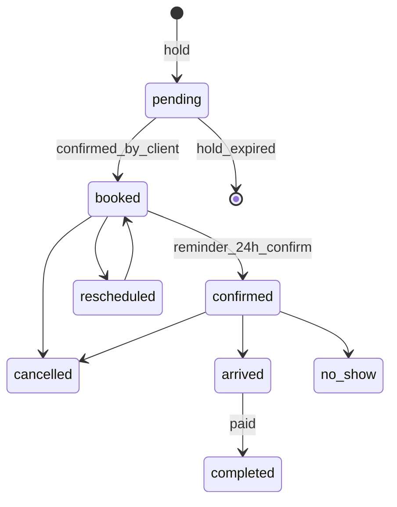
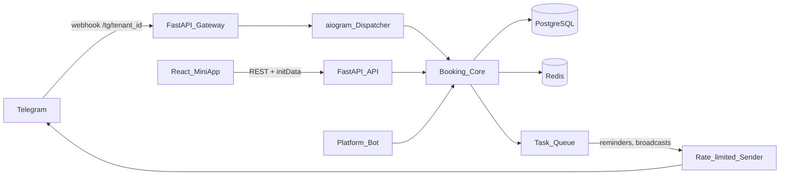

# Beaty: доработка концепции и архитектуры

Сейчас в репозитории только [README.md](README.md) с описанием MVP, кода нет. Ниже мой разбор: что сохранить, что поменять, что добавить. Если план устроит, я перенесу его в документацию репозитория.

Допущения (поправьте, если не так): целевой рынок — Россия/СНГ (отсюда 152-ФЗ, ЮKassa, конкуренты YCLIENTS/DIKIDI/Altegio), мы продаём SaaS по подписке, первые клиенты — небольшие салоны и мастера-одиночки.

---

## 1. Суть продукта: что я бы уточнил

**Ценность для бизнеса:** «свой бот под своим брендом, который заменяет администратора на записи и напоминает клиентам». Главный конкурент — не CRM, а **администратор в WhatsApp/Telegram + тетрадка**, а также бесплатный DIKIDI. Поэтому продаём три вещи:
- Меньше неявок (подтверждения и напоминания) — это деньги, которые легко посчитать.
- Возвраты клиентов (напоминание «пора снова» по каждой услуге).
- Свой бренд: клиент видит бот салона, а не чужой агрегатор, где рядом показывают конкурентов.

**Чего не хватает в идее:**
- **Мастер-одиночка** — самый массовый сегмент. Там владелец, менеджер и специалист — один человек. Роли должны совмещаться, а онбординг должен занимать около 5 минут.
- **Клиенты не из Telegram.** Часть клиентов записывается по телефону или приходит без записи. Менеджер должен уметь заводить «офлайн-клиента» по телефону. Когда этот человек позже запустит бот и поделится контактом, профили склеиваются по номеру.
- **Запись за другого человека** (ребёнка, маму) и групповая запись (подружки на маникюр одновременно).
- **Вариант «Любой мастер»** — для многих клиентов главное время, а не конкретный мастер.

## 2. Ключевые изменения в продуктовой идее

1. **Клиентская запись — через Mini App, а не только через кнопки в чате.** Каталог, выбор услуг с суммой и длительностью, календарь и слоты на inline-кнопках работают медленно, и чат быстро превращается в кашу. Предлагаю гибрид:
   - Mini App (кнопка меню) — каталог, мастера с фото и отзывами, выбор слота, история, профиль.
   - Чат — уведомления и быстрые действия прямо из сообщения: «Подтверждаю / Перенести / Отменить».
   - Текстовый сценарий на кнопках оставить как запасной для простых случаев (повторить прошлую запись в один клик).
2. **Персонал работает в боте самого бизнеса, а не в нашем.** Мастеру неудобно держать два бота. Роль определяется по `telegram_user_id`, команды для персонала показываются только им (`setMyCommands` со scope `chat`), Mini App открывает интерфейс по роли. **Наш платформенный бот** остаётся для владельца: онбординг, подключение токена, оплата подписки, поддержка, новости платформы.
3. **Бренд — это не только токен.** При подключении мы сами задаём через Bot API `setMyName`, `setMyDescription`, `setMyShortDescription` и команды. В Mini App — логотип, цвета, обложка, тон текстов (на «ты» или на «вы», шаблоны сообщений с превью). Аватар ставится вручную в BotFather — даём пошаговую инструкцию со скриншотами.
4. **Точки входа:** deep links (`t.me/bot?start=master_12`, `?start=promo_SPRING`, `?start=ref_<id>`) для Instagram, QR-кода на ресепшене, визиток мастеров и реферальной программы.
5. **«Менеджер узнаёт обо всём» — это шум.** Нужны уровни важности: срочное (отмена менее чем за 2 часа, форс-мажор) — сразу; остальное — в утренний дайджест «сегодня 14 записей, 2 свободных окна» и вечернюю сводку. Всё настраивается.

## 3. Сценарии и сущности, которых нет в README

**Расписание и слоты (ядро продукта):**
- Филиалы (несколько адресов) и часовой пояс филиала. Всё хранится в UTC.
- Цена и длительность зависят от мастера (топ-мастер дороже и/или быстрее), а не только от услуги.
- Буфер после услуги (уборка), перерывы, шаг сетки (15/30 минут).
- Ресурсы: кресло, кабинет, аппарат (лазер). Слот свободен, только если свободны и мастер, и ресурс.
- Шаблон графика (2/2, пн–пт) плюс исключения: отпуск, больничный, разовая смена.
- Ограничения: горизонт записи (например, 30 дней вперёд), минимум времени до записи (не раньше чем через 2 часа), дедлайн бесплатной отмены.
- Набор услуг подряд, в том числе у разных мастеров (стрижка, затем окрашивание у колориста).
- **Удержание слота** на 5–10 минут, пока клиент оформляет запись, и защита от двойной записи на уровне БД.
- **Лист ожидания:** если слотов нет, «сообщите, если освободится» — при отмене первые в очереди получают предложение.

**Жизненный цикл записи:**

- Цена и длительность фиксируются в момент записи: изменения прайса не трогают уже созданные записи.
- Учёт неявок по клиенту. Бизнес может включить правило «после 2 неявок — только по предоплате».
- Опоздание: мастер отмечает его, и клиенту предлагается сократить услугу или перенести запись.

**Напоминания:** вместо жёстких «24 ч / 2 ч / 30 мин» — настраиваемые бизнесом. В напоминании за 24 часа просим кнопку «Подтверждаю» (это главный инструмент против неявок). Без «тихих часов» не обойтись: не будим клиента в 7 утра ради записи на 9:00 — шлём накануне вечером.

**Форс-мажор мастера:** мастер или менеджер отмечает недоступность на диапазон времени. Система находит затронутые записи, и каждому клиенту приходит персональное предложение: другой мастер на то же время, тот же мастер в другое время или отмена. У менеджера есть панель «нерешённые»: если клиент не ответил за X часов, задача уходит менеджеру позвонить.

**Курсы → абонементы/пакеты:**
- Шаблон курса: N сеансов, минимальный и максимальный интервал между ними, срок действия, цена за пакет или за сеанс.
- Тату-проекты — гибкий курс: мастер сам предлагает длительность следующего сеанса.
- Прогресс «3 из 6», предупреждение о скором сгорании пакета, перенос с пересчётом.

**Отзывы:**
- Только после записи в статусе `completed`, один отзыв на визит. Просим через 2–3 часа после визита.
- Бизнес отвечает публично. Прятать отзывы нельзя, можно жаловаться на оскорбления (модерацию делаем мы) — иначе рейтингу нет доверия.
- Плохая оценка (1–3) сразу уходит менеджеру как сигнал: можно вернуть клиента до того, как он напишет на Яндекс.Картах. Хорошая — предлагаем продублировать отзыв на Яндекс/2ГИС.

**Возвраты и маркетинг:**
- Интервал «пора снова» задаётся для каждой услуги (стрижка — 4 недели, маникюр — 3), а не один на весь бизнес. Сообщение персональное, с кнопкой «Записаться к Ивану на пятницу».
- Акции и промокоды с сегментацией (спящие клиенты, конкретная услуга), день рождения (дата — по желанию), лояльность (каждый 6-й визит со скидкой), реферальная ссылка.
- Отписка от маркетинга отдельно от сервисных уведомлений. Лимиты рассылок, чтобы бот не блокировали.

**Финансы (без превращения в бухгалтерию):**
- Факт оплаты по визиту: сумма, способ (наличные / карта / онлайн), скидка, чаевые.
- Схемы оплаты мастера: процент, фикс за услугу, оклад плюс процент. Начисления за период, отметка «выплачено».
- Отчёты: выручка, загрузка мастеров (%), средний чек, неявки, доля вернувшихся клиентов. Экспорт в Excel.
- Предоплата/депозит через Telegram Payments + ЮKassa — позже, но заложить в модель сразу. Telegram Stars для физических услуг не подходят.

**Карта клиента для мастера:** заметки (формула окрашивания, аллергии), фото «до/после» с согласия клиента, история визитов. Это сильная причина, по которой мастер сам захочет пользоваться системой. Фото работ попадает в портфолио мастера в каталоге.

**Права:** Владелец (оплата подписки, удаление бизнеса) → Менеджер (всё операционное) → Мастер (своё). Ресепшен — урезанный менеджер без финансов. Чувствительные действия пишутся в журнал аудита: кто изменил запись или цену.

## 4. Telegram-ограничения, которые влияют на дизайн

- Бот не может написать первым: клиент должен сам нажать `/start`. Отсюда важны deep links и QR-коды.
- Телефон берём через кнопку `request_contact` (номер подтверждён Telegram), а не вводом текста.
- Лимиты: около 30 сообщений в секунду на бота и 1 в секунду в один чат. Рассылки идут через очередь с ограничением скорости.
- Ошибка `403 blocked` — клиент заблокировал бот: помечаем его недоступным и показываем менеджеру «позвонить».
- Отозванный токен (`401`) — сразу предупреждаем владельца через платформенный бот.
- Telegram Business: владелец с Premium может подключить бота к своему личному аккаунту, и бот будет отвечать клиентам в его личных чатах. Хорошая премиум-функция на будущее (вместе с ИИ).

## 5. Техническая архитектура: что я бы изменил

**Главное изменение — отказаться от отдельного Docker-контейнера на каждого бота.** При 200 клиентах это 200 процессов, которые съедают память, а миграции и обновления приходится раскатывать 200 раз. Вместо этого — **один мультитенантный сервис на вебхуках**: каждый бот получает `setWebhook` на `/tg/{tenant_id}` с `secret_token`, а сервис по URL понимает, какой это бизнес. Изоляция логическая (`tenant_id` во всех таблицах, при желании Postgres RLS). Отдельный инстанс оставить как опцию тарифа «Enterprise».

**Стек:**
- Python 3.12 + **aiogram 3** (асинхронный, поддерживает много ботов в одном процессе, есть FSM) вместо `requests`. Синхронный `requests` не масштабируется на сотни ботов.
- **FastAPI** — приём вебхуков и REST API для Mini App (OpenAPI → сгенерированный TS-клиент).
- **PostgreSQL** — основное хранилище. Двойные записи невозможны благодаря exclusion constraint на `tstzrange` по мастеру и ресурсу.
- **Redis** — FSM-состояния, удержание слотов, rate limiting, кэш слотов.
- **Очередь задач** (Taskiq/Arq/Celery) + таблица `scheduled_notifications`: напоминания хранятся в БД и пересчитываются при переносе записи, отправка идемпотентна.
- **React + Vite + Telegram Mini Apps SDK** — одно приложение с разными интерфейсами по роли (клиент / мастер / менеджер). Цвета берутся из `themeParams` Telegram плюс цвета бренда.
- Авторизация Mini App: проверяем HMAC `initData` **токеном конкретного бота-тенанта**.
- S3-совместимое хранилище для фото, Sentry, метрики, ежедневные бэкапы.
- Токены ботов шифруем в БД (Fernet/KMS), в логах их нет.

**Основные сущности:** `tenant`, `branch`, `staff` (роли), `specialist`, `service`, `specialist_service` (цена и длительность), `resource`, `schedule_template`, `schedule_exception`, `client`, `client_profile_per_tenant`, `booking`, `booking_item`, `course_template`, `course_enrollment`, `waitlist`, `review`, `promotion`, `promo_code`, `payment`, `payout_rule`, `notification`, `audit_log`, `subscription` (наша оплата).

**Алгоритм слотов:** рабочие интервалы мастера − исключения − существующие записи и удержания − буферы, затем пересечение со свободными ресурсами, нарезка по шагу сетки с учётом суммарной длительности выбранных услуг. Это отдельный модуль, покрытый тестами (переход на летнее время, полночь, услуги у нескольких мастеров подряд).

## 6. Бизнес-модель и юридическая часть

- Тарифы зависят от числа мастеров. Пробный период 14–30 дней. Бесплатный тариф для одиночки с подписью «сделано на Beaty» — это бесплатное вирусное продвижение.
- Неоплата подписки: мягкая деградация. Существующие записи и напоминания работают ещё N дней, новые записи закрываются. Клиентов салона не наказываем.
- Миграция: импорт клиентов и услуг из Excel/YCLIENTS. Без этого крупным салонам переходить трудно.
- **152-ФЗ:** бизнес — оператор персональных данных, мы — обработчик (нужен договор-поручение). Согласие клиента на обработку при регистрации, политика конфиденциальности, хранение на серверах в РФ, удаление данных по запросу, выгрузка данных при уходе бизнеса.
- Многоязычность (RU/EN/KZ/UZ) заложить через i18n сразу, даже если сначала будет только русский.

## 7. Этапы (вместо одного огромного MVP)

- **MVP:** онбординг через платформенный бот (токен → проверка `getMe` → брендирование), каталог услуг, мастера, графики и исключения, движок слотов, запись / перенос / отмена (Mini App + чат), напоминания с подтверждением, базовый форс-мажор, Mini App менеджера (календарь, записи, ручная запись офлайн-клиента), день мастера, отметка «пришёл / не пришёл / выполнено».
- **V1:** отзывы, «пора снова» по услугам, лист ожидания, курсы и абонементы, акции и промокоды, финансы и выплаты мастерам, дайджесты, карта клиента.
- **V2:** предоплата (ЮKassa), лояльность и рефералы, филиалы и ресурсы, импорт из конкурентов, интеграция с Google Calendar, ИИ-ассистент («запиши меня в пятницу после шести»), Telegram Business.

Метрики успеха: конверсия из `/start` в запись, доля неявок до и после внедрения, загрузка мастеров, доля вернувшихся клиентов, отток бизнесов.

## 8. Что я сделаю после подтверждения

Перепишу документацию в репозитории, чтобы она стала опорой для разработки:
- [README.md](README.md) — короткое описание продукта, ценность, ссылки на документы.
- `docs/product.md` — роли, все пользовательские сценарии и пограничные случаи (разделы 1–4).
- `docs/architecture.md` — архитектура, стек, модель данных, алгоритм слотов, безопасность (раздел 5).
- `docs/business.md` — монетизация, юридические вопросы, метрики (раздел 6).
- `docs/roadmap.md` — этапы MVP / V1 / V2 (раздел 7).
